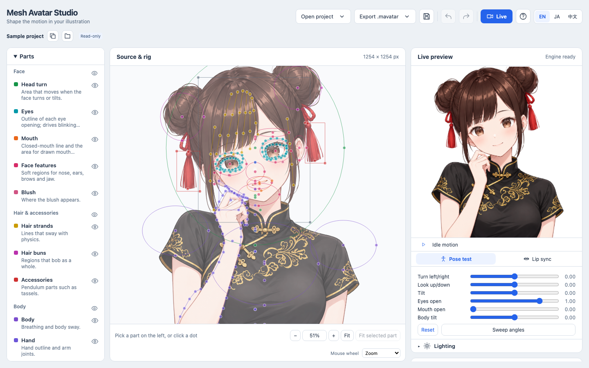
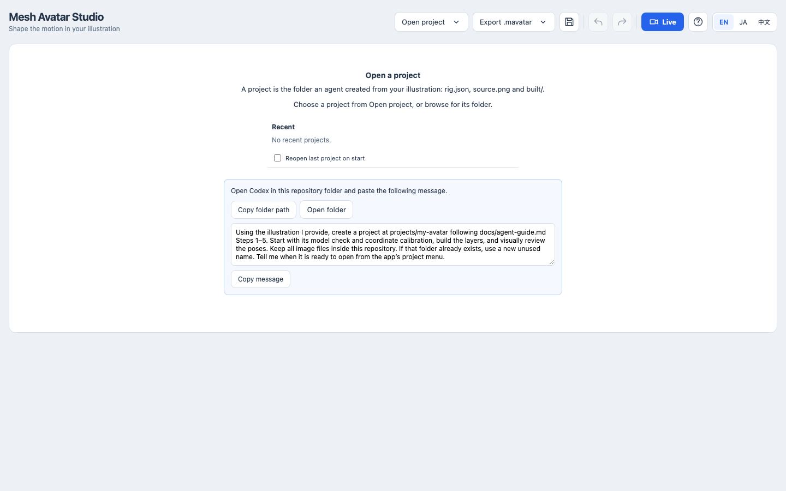
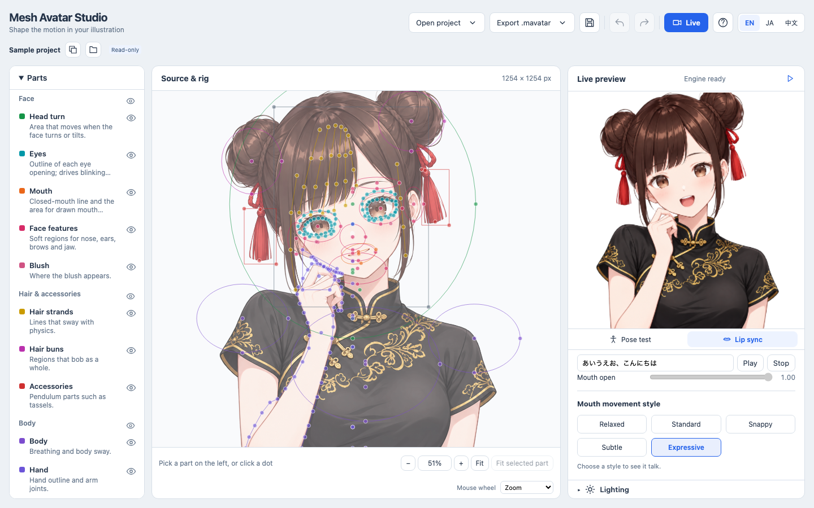
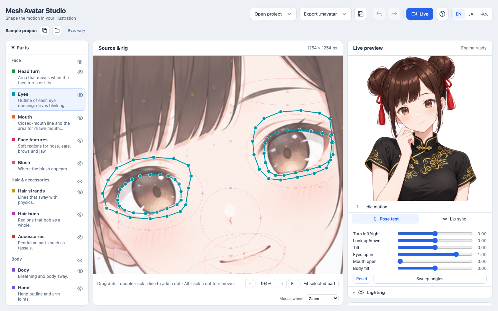
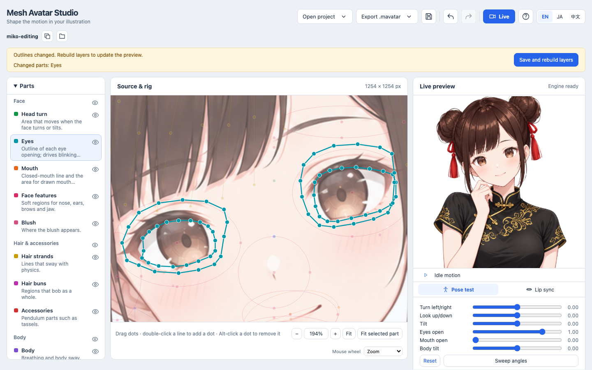
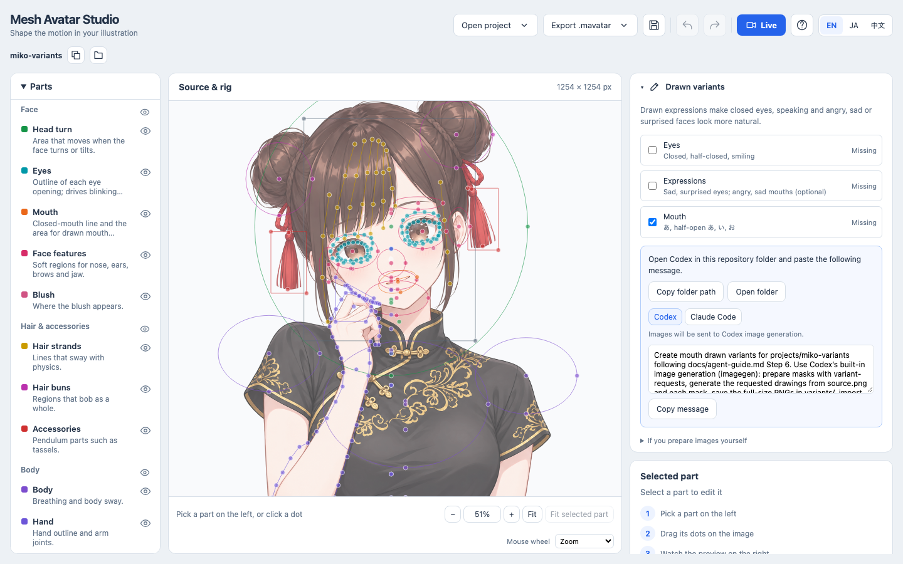

# Mesh Avatar Studio

[English](README.md) · [日本語](README.ja.md)

让一张插画变成会动的 2D 网格虚拟形象：它会眨眼、说话、转头、呼吸、头发自然摆动。虚拟形象由编程助手根据你的插画生成，之后你在本地编辑器里配合实时预览微调动作。

在[项目主页](https://shinshin86.github.io/mesh-avatar-studio/)可以看到动起来的效果。
不想安装任何东西、直接用自己的脸和声音驱动它，可以用 Chrome 或 Edge 打开
[Player](https://shinshin86.github.io/mesh-avatar-studio/play/)。



## 试用示例

需要 Node.js 22.17+ 和 Git。

```sh
npx create-mesh-avatar-studio
cd mesh-avatar-studio
npm run dev
```

第一条命令会下载本仓库、安装依赖，并检查 Studio 需要的工具。如果是自己 clone 的仓库，先运行 `npm install`，再运行 `npm run doctor` 做同样的检查。编辑器和直播（Live）页面只需要 Node.js；uv 和 Python 用于重建图层，Playwright Chromium 用于在助手生成虚拟形象时渲染动作审查——检测会逐一提示缺少哪一个。

打开终端里打印的地址（例如 `http://127.0.0.1:5173/`）。编辑器会打开内置示例：身穿旗袍的 Miko。在左侧选一个部件，在图上拖动它的控制点，右侧查看预览。示例是只读的；做出修改后，选择**复制并继续编辑**，在你自己的副本里继续。

### 使用 Windows

尽量使用 `git clone` 下载仓库。如果使用 ZIP 压缩包，先在文件资源管理器里打开它的属性，若出现 **解除锁定** 选项，勾选后再解压。

在让编程助手处理项目之前，先在你的 Windows 账户下自己创建 `projects/` 文件夹（`npx create-mesh-avatar-studio` 会自动创建）。
由其他账户或沙箱中的助手创建的文件夹可能带有限制权限，编辑器可能无法读取。如果项目无法读取，通过文件夹的**属性 → 安全**设置，把整个项目（包括文件和子文件夹，通过权限继承）授权给你的账户。

## 工作原理

从你的插画制作虚拟形象需要四步。步骤 1 和 4 由编程助手（Claude Code 或 Codex）在本仓库内完成；步骤 2 和 3 在编辑器中进行。

### 1. 让助手创建虚拟形象

在本仓库文件夹中打开 Claude Code 或 Codex，把你的插画交给它：

> 请按照 docs/agent-guide.zh.md 用这张图片创建虚拟形象：`/path/to/your-image.png`

助手会遵循 [Agent 指南](docs/agent-guide.zh.md)：检查读取坐标的准确度、在放大网格上放置绑定、将图片切成图层，并以固定动作审查形象。项目保存在 `projects/<name>/`，不会被提交到 Git。正面、头肩出镜、透明背景的 PNG 效果最好。未打开项目时，编辑器会直接显示这段可直接复制的请求。



推荐的配置：

| 助手 | 模型 |
|---|---|
| Claude Code | Claude Opus 5.5 |
| Codex | GPT-6.1 Sol |

### 2. 打开项目并检查

启动编辑器（`npm run dev`），选择**打开项目**，从列表中挑选你的项目。在预览里使用**姿态测试**转头、倾斜头部、闭眼。在**嘴型测试**里选择口型样式，输入假名文本试试效果。打开**高级设置**调整动作幅度、大小和闭合度，或预览本地音频文件。



### 3. 拖动控制点修正问题

在左侧选择一个部件，它在图上的控制点会高亮显示；拖动控制点修正位置。预览会立即跟随你的修改。有些数值也决定图片如何切成图层：眼睛和手的轮廓，以及用于头发蒙版的头部、头发和发髻区域。修改这些之后会出现横幅，在里面选择**保存并重建图层**，需要几秒钟。





用双指捏合或 Ctrl/Cmd+滚轮缩放，双指或拖动空白处平移，用**定位选中部件**跳转到当前部件。

### 4. 获取绘制的眼睛和嘴型

没有绘制的图片时，眼睛和嘴只能靠网格变形运动。绘制的闭眼和元音嘴型会让眨眼和说话自然得多。在**表情差分**里勾选**眼睛**、**嘴型**或两者，复制请求，粘贴到在本仓库中打开的 Codex。Codex 会用内置的生图功能绘制并导入；编辑器会自动重新加载。（Claude Code 不能生成图片；它的请求会帮你准备好蒙版和提示词，交给其他生图工具。）

**表情**是可选的：它会添加绘制的悲伤、惊讶的眼睛，以及生气、悲伤的闭嘴形象。虚拟形象在对应表情和情绪标签下会切换到这些形象，同时仍然会眨眼和说话；没有这些形象时，外观和之前一样。



## 分享你的虚拟形象

在编辑器里选择**导出 .mavatar**，下载一个包含已保存绑定、构建图层、绘制表情和形象元数据的单文件。**包含原图**默认开启，方便接收者在 Studio 里编辑。如有未保存的修改，使用**保存并导出**；修改过轮廓需要先重建图层。只读视图会导出原始文件。

在**打开项目**中选择**导入 .mavatar**，或直接把文件拖进去。Studio 会在 `projects/` 下创建新文件夹，若已有同名项目会使用新名称。导入需要 `npm run dev`，接受最大 128 MiB 的压缩包。没有原图时，导入的虚拟形象可以播放但不能编辑或重建。不包含原图并不会移除已构建的图片。文件内容详见[虚拟形象格式](docs/format.md)。

## 直播与 OBS


在编辑器里打开你的项目，选择**直播**。启动摄像头，面朝正前方，眼部放松、嘴闭合，然后选择**校准**。你可以调整镜像、灵敏度和平滑度，或启用麦克风口型同步。摄像头画面和麦克风音频都留在本机；直播画面只接收虚拟形象的动作数值。

选择背景后**复制 OBS 地址**，或先**在新标签页打开直播画面**检查。保持直播页面打开，在 OBS 里把该地址添加为**浏览器来源**，例如设为 **1080 × 1080**。透明背景在 OBS 中可直接使用。其他采集软件请选择绿色并添加色度键。两个页面都通过本地开发服务器（`npm run dev`）运行。直播页面停止发送更新时，直播画面会显示待机动作。

可选的**光照**会在你拖动的光源处生成跟随的阴影。默认关闭；在直播页面底部或编辑器预览下方打开对应区域即可。OBS 地址包含光照设置，详见[光照](docs/reference.md#lighting)。

把直播页面放在单独的窗口里保持打开。在 OBS 内部或另一个标签页打开 OBS 地址；不要把它粘到正在运行的直播标签页里。如果页面提示在被隐藏时追踪已停止或变慢，把它切回前台。


在追踪继续的同时，用**表情**按钮或按 **1**–**8** 键切换微笑、惊讶、眨眼等表情。当 OBS 等其他应用在前台时，可用 Stream Deck 按键或键盘快捷键切换；macOS 快捷指令按键并非在所有应用中生效（[详情](docs/reference.md#switching-expressions-from-other-apps)）。

最多可保存八个光照预设，例如从下往上的红色光用于恐怖游戏，用 **Shift**+**1**–**8** 或同类快捷键切换（[详情](docs/reference.md#lighting-presets)）。

摄像头是可选的：只开麦克风时，虚拟形象保持待机动作，用声音驱动嘴型。要在 Zoom、Google Meet 等应用中以虚拟形象出镜，使用 OBS 虚拟摄像头（[步骤](docs/reference.md#video-calls)）。

直播画面选项、故障排查和隐私细节见[参考文档](docs/reference.md#live-and-streaming)。

### 免安装使用

[Player](https://shinshin86.github.io/mesh-avatar-studio/play/) 完全在浏览器内运行面部追踪、麦克风口型同步、表情和光照。打开示例或你自己的 `.mavatar` 文件即可，不会上传任何内容。它没有直播地址：选择**打开虚拟形象窗口**（Chrome 或 Edge），在 OBS 里用**窗口采集**配合绿色背景和色度键滤镜添加该窗口。透明背景、OBS 浏览器来源和从其他应用切换表情需要使用 Studio 的直播页面。

## 发布

要修改 `mesh-avatar`，运行 `npm run changeset` 并把生成的文件包含在你的 PR 里。在 `main` 分支上，GitHub Actions 会打开或更新一个 `chore: version packages` PR，其中包含下一个版本号和更新日志；合并后会把 `mesh-avatar` 发布到 npm 并附带 provenance。Studio 根包保持私有。发布使用 npm 的 trusted publishing：在 npmjs.com 上为 `mesh-avatar` 添加一个 trusted publisher，指定本仓库和 `release.yml` 工作流，无需在仓库中保存 npm token。npm 无法匹配到 trusted publisher 的发布会停在 Staged Packages 标签页，等待维护者用 2FA 审批。在仓库 Settings → Actions → General 中，启用 **Allow GitHub Actions to create and approve pull requests**，工作流才能打开版本 PR。提交 PR 前请先本地运行 `npm run e2e`；CI 会运行其他检查，但不安装 Playwright 浏览器。

## 更多

- [Agent 指南](docs/agent-guide.zh.md)：助手逐步执行的操作流程
- [参考文档](docs/reference.md)：项目结构、手动重建图层、所有编辑器控件、测试
- [绑定字段说明](docs/rig-fields.md)：`rig.json` 中每个值的意义
- [虚拟形象格式](docs/format.md)：文件夹和 `.mavatar` 结构、元数据和校验

## 许可证

代码依据 [MIT License](LICENSE) 发布。

示例角色 Miko（`samples/miko-qipao/`）不受 MIT License 覆盖。Miko 是 AITuber OnAir 的角色，© Yuki Shindo（AITuber OnAir），其图像依据[Miko 角色使用指南](https://miko.aituberonair.com/#terms)提供，详见 [samples/miko-qipao/MIKO_ASSET_TERMS.md](samples/miko-qipao/MIKO_ASSET_TERMS.md)。可作为你自己作品的一部分使用或修改，但不得单独分发或作为素材集合分发。本项目不是 AITuber OnAir 的官方产品。

面部追踪使用 [MediaPipe](https://github.com/google-ai-edge/mediapipe)（`@mediapipe/tasks-vision` 以及 `vendor/mediapipe/` 中的 Face Landmarker 模型），© The MediaPipe Authors，依据 Apache License 2.0 授权，详见 [vendor/mediapipe/LICENSE](vendor/mediapipe/LICENSE)。
